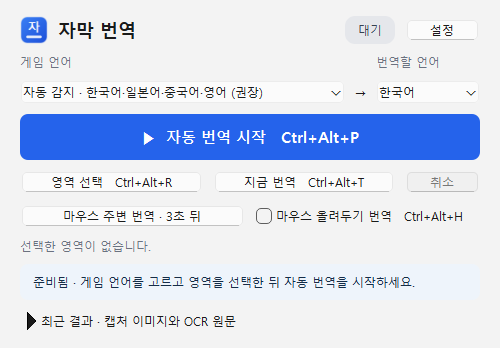
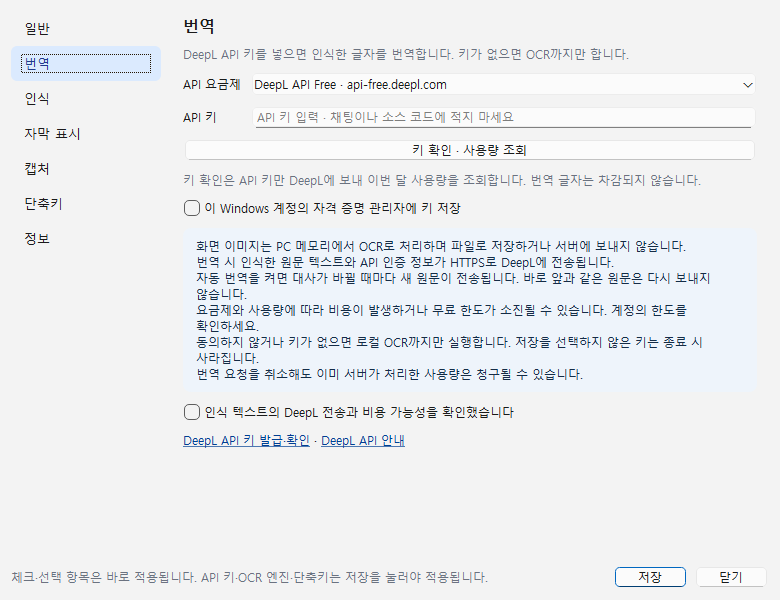
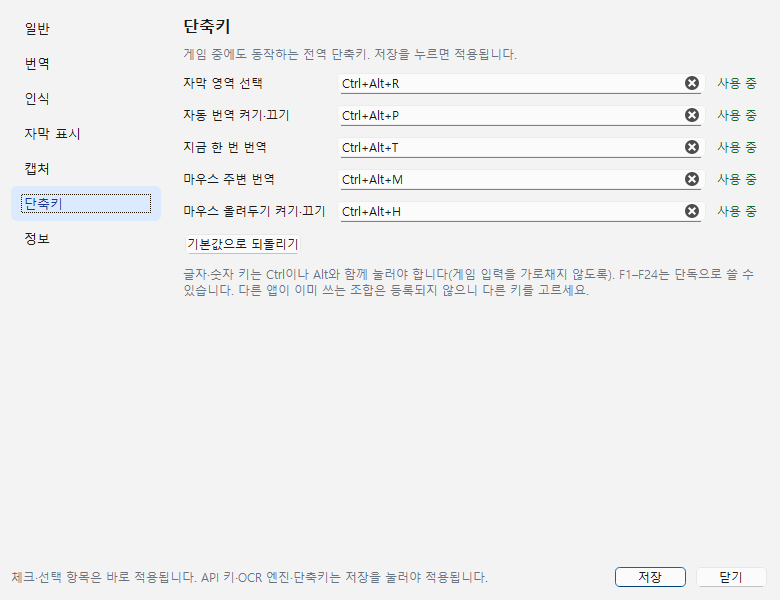

# 앱 화면·설정 개편 — 계획과 결과

작성 2026-11-01 · 백로그 P-29 · 브랜치 `ocr-accuracy-foreign-only` · 기준 커밋 `ae5b295`

요청: "사용자 기준 편의성, 인터페이스, 설정을 진짜 앱처럼. 인터넷의 비슷한 앱을 참고해서."

## 1. 현재 상태

| 항목 | 지금 동작 | 근거 | 문제 |
|---|---|---|---|
| 메인 창 | 760×880 한 화면에 모니터·언어·버튼 8개·체크 4개·범위·미리보기·원문·안내문 3줄이 모두 나열 | `main_window.cpp` 생성자 | 무엇부터 눌러야 할지 안 보임. 자주 쓰는 것(자동 번역)과 가끔 쓰는 것(모니터, 범위, 이미지 파일)이 같은 무게 |
| 설정 | 한 페이지짜리 모달 창, OCR·DeepL만 | `MainWindow::settings()` | 자막 표시·캡처 옵션은 메인 창에, 단축키는 설정할 곳이 없음 |
| 닫기 | X를 누르면 앱 종료 | `closeEvent` | 게임 중에 단축키만 쓰려 해도 창을 켜 둬야 함. 트레이 없음 |
| 단축키 | Ctrl+Alt+T/P/R/M/H 고정, 다른 앱이 쓰면 F7–F9 대체 | 생성자 `RegisterHotKey` | 바꿀 수 없음 |
| 자막 모양 | 글자 크기는 원문 높이로 자동(16–36px), 흰 글자 + 검은 테두리 고정 | `subtitle_overlay.cpp` | 밝은 배경에서 읽기 어려워도 바꿀 수 없음 |
| 아이콘 | 없음(기본 창 아이콘) | — | 작업 표시줄·트레이에서 구분이 안 됨 |

## 2. 참고한 앱

| 앱 | 가져올 점 |
|---|---|
| [Translumo](https://github.com/Danily07/Translumo) | 설정 창 단축키(Alt+G), 단축키 설정 페이지와 기본값 복원([Translumo-LLM](https://github.com/Chaobs/Translumo-LLM/releases)), 창 모드 권장 안내 |
| [LunaTranslator](https://github.com/Mupu/LunaTranslator) ([도구 버튼 문서](https://gitcode.com/GitHub_Trending/lu/LunaTranslator/blob/65051f452620499a16ee9e6d20dca94b15ce566e/docs/en/alltoolbuttons.md)) | 번역 창의 작은 도구 버튼(영역 선택·클릭 통과·잠금), 트레이로 최소화, 게임별 설정 |
| [Trayslate](https://plaintool.github.io/trayslate/) | 트레이에 상주하며 전역 단축키 유지, 항상 위 표시와 투명도 조절 |

공통점: **트레이 상주 + 전역 단축키 + 분류된 설정 창 + 자막 모양 조절**. 메인 창은 자주 쓰는 동작만 보여 준다.

## 3. 목표와 범위

목표: 처음 쓰는 사람도 "언어 고르기 → 영역 선택 → 자동 번역" 순서가 한눈에 보이고, 게임 중에는 트레이와 단축키만으로 쓸 수 있게 한다.

| ID | 바꿀 것 | 종류 | 우선 |
|---|---|---|---|
| U1 | 트레이 아이콘: 메뉴(창 열기·영역 선택·지금 번역·자동 번역·마우스 올려두기·설정·종료), 두 번 클릭으로 창 열기, 상태 표시 | 신규 | P1 |
| U2 | X는 트레이로 숨기기(설정에서 끌 수 있음), 처음 한 번 알림. `--auto` 실행은 트레이에서 시작 | 신규 | P1 |
| U3 | 메인 창을 조작판으로: 상태 배지, 언어 한 줄, 큰 자동 번역 버튼, 영역 선택·지금 번역, 마우스 번역·올려두기, 상태 카드, 접을 수 있는 "최근 결과" | 수정 | P1 |
| U4 | 설정 창을 왼쪽 목록 + 페이지 7개로: 일반·번역·인식·자막 표시·캡처·단축키·정보 | 수정 | P1 |
| U5 | 단축키 변경: 동작마다 입력 칸, 등록 상태(사용 가능·다른 앱이 사용 중), 기본값 복원. 상태 문구도 실제 단축키로 표시 | 신규 | P1 |
| U6 | 자막 모양: 글자 크기(자동·작게·크게), 배경(테두리만·반투명 상자) | 신규 | P2 |
| U7 | 앱 아이콘(코드로 그림, 파일 추가 없음), Windows 시작 시 실행(기본 꺼짐) | 신규 | P2 |

범위 밖:
- **번역 기록 창**: 원문·번역을 메모리에 쌓는 것까지는 원칙과 맞지만, 이번 범위를 넘는다.
- **게임별 언어 설정**: 영역은 이미 게임별로 저장된다.
- **게임 패드 단축키**: 수요 확인 전.

## 4. 설계

- **파일**: 새 UI 코드는 `src/main_window_ui.cpp`(MainWindow의 멤버 함수)에 둔다. 1,238줄인 `main_window.cpp`를 더 키우지 않아서, 다음 수정 때 읽는 양(토큰)이 줄어든다.
- **위젯 이름 유지**: 테스트가 쓰는 멤버(`auto_`, `hoverMode_`, `inlineCaptions_`, `followGame_`, `cursorSizeBox_`, `showCaptureRange_`, `screens_` 등 30여 개)는 이름을 그대로 두고 위치만 옮긴다. 설정 창은 생성자에서 한 번 만들어 계속 둔다.
- **설정 적용 방식**:
  - 체크·선택 항목(자막 표시·캡처·일반)은 지금처럼 **바로 적용**된다.
  - DeepL 키·OCR 엔진·단축키는 **저장 버튼**으로 적용된다. 키 저장(자격 증명 관리자)과 단축키 재등록이 한 번에 일어나야 하기 때문이다.
- **단축키**:
  - 동작별 기본값과 대체 키(F7–F9)를 표 하나로 관리한다. 저장 값은 `hotkeys/<동작>`에 넣는다.
  - 글자·숫자 키는 Ctrl·Alt 중 하나가 있어야 하고, F1–F24는 단독으로도 쓸 수 있다. 게임 입력을 가로채지 않기 위해서다.
  - 같은 키 중복은 거부한다.
  - 사용자가 직접 정한 키는 대체 키로 바꾸지 않고 "다른 앱이 사용 중"으로 표시한다.
- **트레이**:
  - `QApplication::setQuitOnLastWindowClosed(false)`. 메인 창이 숨은 상태에서 결과 창을 닫아도 앱이 꺼지지 않게 한다.
  - 종료는 트레이 메뉴, 또는 "트레이로 숨기기"를 끈 상태의 X로만 한다.
- **정합성**:

| 원칙·결정 | 확인 |
|---|---|
| 게임을 방해하지 않는다 | 트레이 메뉴는 사용자가 열 때만 나온다. 앱 창은 계속 활성화 없이 표시된다(`WA_ShowWithoutActivating`). 단축키 기본값은 그대로 |
| 이미지·원문을 파일로 저장하지 않음 | 새 설정은 모양·동작 값뿐 |
| 앱 창이 자막 영역을 가리면 읽지 않음 | 메인 창이 작아지고 트레이로 숨길 수 있어 오히려 덜 가린다 |
| 키 저장은 사용자가 선택 | 번역 페이지로 옮기되 동작은 같음 |
| 테스트 건너뜀 0 | 기존 33개 UI 테스트 + 새 테스트 |

## 5. 검증 계획

| ID | 확인할 것 | 방법 | 합격 기준 |
|---|---|---|---|
| V1 | 기존 기능 회귀 없음 | CTest 7개 그룹 | 실패 0, 건너뜀 0 |
| V2 | 트레이로 숨기기·메뉴 동작 | 새 UI 테스트 | X 후 창이 숨고 앱 유지, 메뉴로 자동 번역·올려두기 전환이 버튼과 같이 바뀜 |
| V3 | 단축키 변경 | 새 UI 테스트 | 새 키 등록·표시·상태 문구 반영, 잘못된 키(수정키 없는 글자, 중복) 거부, 기본값 복원 |
| V4 | 자막 모양 | 새 UI 테스트 | 크게는 글자가 커지고, 배치 규칙(원문 아래, 가리지 않음) 유지 |
| V5 | 화면 확인 | 실제 앱 캡처 | 메인 창·설정 각 페이지가 잘리지 않음 |

## 6. 결과

### 바뀐 화면

| 메인 창 (수정 전 760×880) | 설정 · 번역 | 설정 · 단축키 |
|---|---|---|
|  |  |  |

나머지 페이지: [일반](../evidence/app-ui-2026-11-01/settings-0.png) · [인식](../evidence/app-ui-2026-11-01/settings-2.png) · [자막 표시](../evidence/app-ui-2026-11-01/settings-3.png) · [캡처](../evidence/app-ui-2026-11-01/settings-4.png) · [정보](../evidence/app-ui-2026-11-01/settings-6.png). 수정 전: [2026-10-25 메인](../evidence/usability-2026-10-25/main-ui.png).

### 항목별 결과

| ID | 결과 |
|---|---|
| U1 | 트레이 메뉴 7개 항목. 자동 번역·마우스 올려두기 체크 표시가 버튼·단축키와 같이 바뀜. 툴팁에 현재 상태 표시 |
| U2 | X를 누르면 트레이로 숨고, 처음 한 번 알림을 띄움. `--auto` 실행(바탕 화면·시작 메뉴 바로가기)은 창 없이 트레이에서 시작. 종료는 트레이 메뉴 |
| U3 | 메인 창 500×약 350. 상태 배지(대기·자동 번역 중·처리 중), 큰 자동 번역 버튼(켜지면 빨간 "멈추기"). 최근 결과는 접혀 있다가 펼칠 때만 창이 커짐. 안내문 3줄은 설정 > 정보로 이동 |
| U4 | 설정 7쪽. 메인 창에 있던 모니터·마우스 범위·자막 표시·게임 창 따라가기·읽은 범위 옵션을 각 페이지로 옮김. 처음 실행은 번역 페이지로 열림 |
| U5 | 동작 5개의 단축키 변경, 등록 상태(초록 "사용 중" / 빨강 "다른 앱이 쓰는 중"), 기본값 복원. 상태 문구 35곳이 실제 단축키로 표시됨 |
| U6 | 글자 크기 작게(0.8)·기본·크게(1.25)·아주 크게(1.5), 배경 테두리만·반투명 상자. 바로 적용되고, 떠 있는 자막도 다시 그림 |
| U7 | 파란 타일에 "자" + 자막 막대 아이콘(코드로 그림). 작업 표시줄·트레이·창에 적용. Windows 시작 시 실행은 `HKCU\...\Run`, 기본 꺼짐 |

### 검증

- **CTest**: 7개 그룹 **180 통과**, 실패 0, 건너뜀 0(UI 37). 새 테스트 4개는 아래와 같다.
  - `closeHidesToTrayAndMenuFollowsState`
  - `shortcutsCanBeChangedAndRestored`: 수정키 없는 글자, Shift만 있는 글자, Space를 거부한다.
  - `captionStyleScalesTextAndKeepsPlacement`
  - `settingsPagesAreComplete`: `SUBTITLE_TEST_SCREENSHOTS`로 위 화면을 저장한다.
- **V5 화면 확인**: 7쪽 모두 잘리지 않음(스크롤 영역 안), 메인 창은 컨트롤만큼만.
- **파일 분리**: `main_window.cpp`는 1,238 → 874줄로 줄었다. 새 화면 코드는 `main_window_ui.cpp`(837줄)에 있다.

### 아직 확인하지 못한 것

- **어두운 테마**: 상태 카드·배지 색은 밝은 테마 기준이다. Windows 어두운 모드에서의 대비는 확인하지 않았다.
- **고해상도 배율**: 아이콘 그림의 125·150% 배율 표시는 이 PC(100%)에서만 봤다 → P-14.
- **번역 기록 창**: 범위 밖으로 남겼다(3절).
