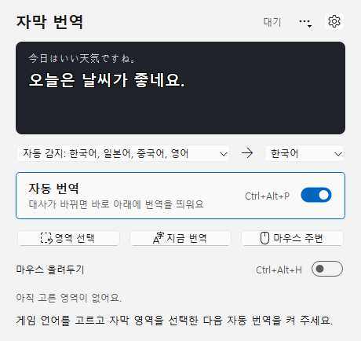
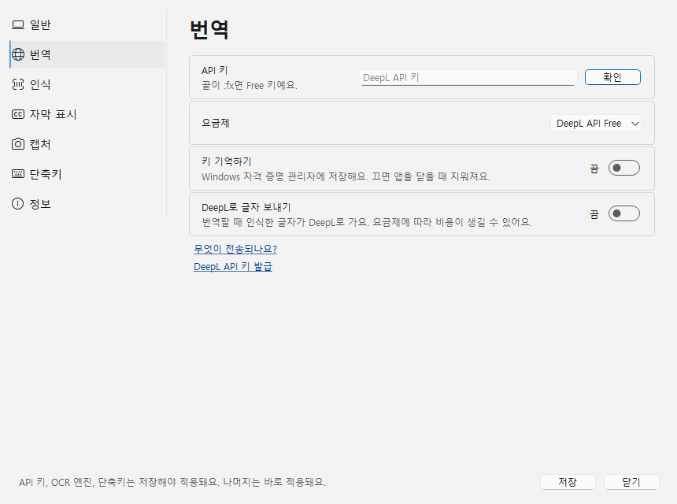
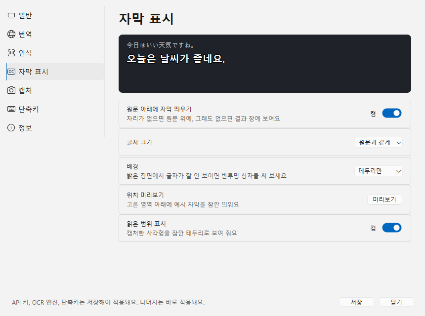

# 화면 디자인 다듬기 (AI 템플릿 느낌 걷어내기) — 계획과 결과

작성 2026-11-01 · 백로그 P-30 · 기준 커밋 `ca07155` · 사용 스킬: [frontend-design](https://github.com/anthropics/skills/tree/main/skills/frontend-design) (Apache-2.0, `~/.claude/skills/frontend-design`에 설치)

요청: "너무 AI스러워. 스킬을 추가해도 좋으니 인터넷 레퍼런스를 많이 참고해서 디자인."

## 1. 무엇이 AI스러웠나

P-29 화면을 스킬의 "생성된 디자인의 흔한 표시" 목록과 대조했다.

| 표시 | P-29 화면 |
|---|---|
| 가운뎃점으로 이어 붙인 문자열 (`A · B · C`) | 버튼·설명·상태 문구 37곳 ("마우스 주변 번역 · 3초 뒤", "자동 번역 중 · …") |
| 어느 제품에나 나오는 기본 색 | Tailwind 파랑(#2563EB) 큰 버튼, 회색 알약 배지, 연파랑 안내 상자 |
| 의미 없는 기호 | `▶ 자동 번역 시작`, `■ 멈추기` |
| 설명 과잉 | 페이지마다 요약 문장, 체크 항목마다 긴 툴팁·안내 문단 |
| 그라데이션 아이콘 | 파랑 그라데이션 타일 위의 "자" |
| 섞인 말투 | 합니다체와 명사형이 문장마다 바뀜 |

## 2. 레퍼런스

| 출처 | 가져온 것 |
|---|---|
| [Windows 11 지오메트리](https://learn.microsoft.com/en-us/windows/apps/design/signature-experiences/geometry) | 모서리 반경 위계: 창·오버레이 8px, 컨트롤 4px |
| [Windows 앱 디자인 지침](https://learn.microsoft.com/windows/apps/design/guidelines-overview) | Segoe UI Variable, 시스템 강조색, Fluent 아이콘 |
| [PowerToys 설정](https://learn.microsoft.com/en-us/windows/powertoys/general) ([Windows 11 스타일 개편](https://winaero.com/windows-powertoys-get-visual-updates-similar-to-windows-11-ui)) | 왼쪽 아이콘 목록 + 페이지 제목 + "제목·설명 / 오른쪽 컨트롤" 줄, 켬·끔은 토글 스위치 |
| [DevToys 설정 지침](https://devtoys.app/doc/articles/extension-development/guidelines/UX/basic-input/setting.html) | 설정 한 줄 = 아이콘·제목·설명·컨트롤, 켬·끔 값은 스위치 |
| [토스 UX 라이팅 인터뷰](https://toss.im/tossfeed/article/uxwriter-interview), [실전 UX 라이팅](https://ditoday.com/?p=63822), [핀테크 UX 문구 연구](https://koreascience.kr/article/JAKO202322957621664.pdf) | 짧은 문구, 한 줄을 넘기지 않기, 해요체 한 가지, 전문용어 피하기 |
| Translumo · LunaTranslator · Trayslate (P-29) | 트레이 상주, 단축키 페이지 |

## 3. 디자인 계획

주제: 게임 대사창 바로 아래에 한국어 자막을 띄우는 Windows 도구. 사용자는 일본어·영어 게임을 하는 사람이다. 주된 일은 게임 중에 자동 번역을 켜고 끄고, 영역을 고르는 것이다.

**한 곳에만 힘을 준다: 자막 무대.** 메인 창 맨 위에 마지막 대사를 게임 위에 뜨는 모습 그대로 보여 준다. 같은 그리기 코드, 같은 크기·배경 설정을 쓴다. 이 제품만의 장면이고, 자막 표시 설정의 실시간 미리보기 역할도 한다. 나머지는 Windows 11 기본 앱처럼 조용하게 둔다.

| 토큰 | 값 | 이유 |
|---|---|---|
| Scene | `#1F2228` | 무대 배경. 어두운 게임 화면. 순수 검정·#111 대신 장면 색 |
| Caption | `#FFFFFF` | 실제 자막 글자 |
| Outline | `#000000` 86% | 실제 자막 테두리 |
| Source | `#C9CED6` | 무대 위 원문 줄. 번역보다 한 단계 약하게 |
| 화면 바탕·글자·선 | Windows 시스템 팔레트 | 밝은·어두운 모드를 그대로 따름 |
| 강조 | 사용자의 Windows 강조색 | 스위치·포커스에만 사용. 제품이 고른 파랑 대신 사용자 PC의 색 |

- **글꼴**: Segoe UI Variable Text(라틴·숫자) + 맑은 고딕(한글), 즉 Windows 11 시스템 조합이다.
  - 크기: 제목 20px semibold, 본문 14px, 설명·단축키·상태 12px.
  - 무대의 번역 줄만 맑은 고딕 Bold로, 실제 자막 크기를 쓴다.
- **아이콘**: Segoe Fluent Icons(Windows 10은 Segoe MDL2 Assets). 단색, 16px.
- **모서리**: 무대·창 8px, 버튼·설정 줄 4px. 그림자와 그라데이션은 쓰지 않는다.
- **배치**: 한 열, 왼쪽 정렬.

```text
자막 번역                                 대기   ⚙
┌ 무대 8px ───────────────────────────────────┐
│ 今日はいい天気ですね。              (원문, 약하게) │
│ 오늘은 날씨가 좋네요.          (자막 그대로, 굵게) │
└──────────────────────────────────────────────┘
일본어 ▾                   ⟶            한국어 ▾
┌ 자동 번역                        Ctrl+Alt+P  ━● ┐
└ 대사가 바뀌면 바로 번역해요                       ┘
[⬚ 영역 선택] [A字 지금 번역] [🖱 마우스 주변]   [⋯]
마우스 올려두기                     Ctrl+Alt+H  ○━
상태 한 줄 (보조 글자색)
```

- 설정 창은 PowerToys·Windows 설정 방식으로 바꾼다.
  - 왼쪽: 아이콘이 붙은 목록.
  - 오른쪽: 큰 페이지 제목, 그 아래 설정 줄을 쌓는다. 줄은 4px, 시스템 색 1px 선, 2px 간격이다.
  - 켬·끔은 스위치로 한다.
  - 안내 문단은 없애고, 꼭 필요한 설명만 줄 아래 한 줄로 쓴다.
  - 개인정보 안내는 "자세히"를 눌렀을 때만 펼친다.
- **문구**:
  - 이름은 명사로 쓴다("자동 번역", "영역 선택").
  - 설명과 상태는 한 줄 해요체로 쓴다.
  - 단축키는 이름에 붙이지 않고 보조 글자로 오른쪽에 둔다.
  - 가운뎃점 나열, `▶ ■`, 버튼 끝의 `→`는 쓰지 않는다.
  - 오류는 무엇이 안 됐고 무엇을 하면 되는지를 말한다.

### 템플릿 기본값 점검 (계획 검토)

| 1차 안 | 문제 | 고친 안 |
|---|---|---|
| 어두운 게이밍 테마 + 형광 강조색 | 스킬 목록 2번(검정 배경 + 단일 형광색). 게임 앱이면 누구나 떠올림 | 화면 전체는 시스템 팔레트, 어두운 건 무대 하나 |
| 상태를 알약 배지로 | 템플릿 장식 | 제목 줄 오른쪽의 보조 글자 한 단어 |
| 모든 영역을 같은 둥근 카드로 | 스킬 목록 4번(SaaS 카드 키트) | 반경 위계 8/4, 그림자 없음. 설정 줄은 Windows 설정처럼 붙여 쌓음 |
| 앱 아이콘 그라데이션 | 장식 | 무대 모티프를 납작하게: 어두운 타일 + 흐린 원문 줄 + 흰 자막 줄 |

## 4. 검증

| ID | 확인할 것 | 합격 기준 |
|---|---|---|
| V1 | 회귀 | CTest 실패 0, 건너뜀 0 |
| V2 | 가운뎃점·기호 제거 | `src`의 사용자 문구에 `·`, `▶`, `■` 0곳 (정보 페이지 링크 구분 제외) |
| V3 | 무대 | 번역이 끝나면 원문·번역이 무대에 나오고, 자막 크기·배경 설정이 바로 반영됨 |
| V4 | 화면 확인 | 메인·설정 7쪽, 밝은 모드 캡처를 보고 스스로 비평. 어두운 모드는 팔레트를 바꿔 렌더링 |

## 5. 결과

### 바뀐 화면

| 메인 (대사가 있을 때) | 설정 · 번역 | 설정 · 자막 표시 |
|---|---|---|
|  |  |  |

이전 화면(P-29): [메인](../evidence/app-ui-2026-11-01/main.png), [설정](../evidence/app-ui-2026-11-01/settings-1.png).

### 항목별 결과

- **무대(`CaptionStage`)**: 메인 창 맨 위에 마지막 원문(약하게)과 번역(실제 자막과 같은 렌더러)을 보여 준다. `SubtitleOverlay::paintCaption`을 무대와 오버레이가 함께 쓴다. 자막 표시 페이지 맨 위에도 같은 무대를 두어, 크기·배경을 바꾸면 바로 보인다.
- **시스템 색**: Tailwind 파랑, 알약 배지, 연파랑 상자, 스타일시트(`MainStyle`)를 모두 없앴다.
  - 모든 그리기는 `palette()`에서 색을 가져오므로 Windows 밝은·어두운 모드를 따른다.
  - 아이콘은 테마가 바뀌면 다시 그린다(`changeEvent`).
- **스위치**: `ToggleSwitch`(QCheckBox를 상속해 기존 코드와 테스트가 그대로 동작)와 `SwitchRow`(자동 번역).
  - 끈 상태의 설정 줄은 Windows 설정처럼 "켬/끔"을 표시한다.
  - 포커스는 테두리로 보인다.
- **아이콘**: Segoe Fluent Icons 9종(영역 선택 E8E6, 지금 번역 E8C1, 마우스 E962, 자막 E7F0, 인식 EE6F, 단축키 E765, 번역 E774, 캡처 E722, 정보 E946).
  - 앱 아이콘은 무대를 줄인 모양으로 바꿨다. 어두운 타일 위에 흐린 원문 줄과 흰 자막 줄이 있다.
- **설정 창**: 왼쪽에 아이콘 목록, 오른쪽에 26px 페이지 제목과 `SettingRow`(제목·설명 / 오른쪽 컨트롤)를 둔다.
  - 페이지마다 있던 요약 문장을 없앴다.
  - 개인정보 안내는 "무엇이 전송되나요?" 링크를 눌러야 펼쳐진다.
  - 키 확인·설치 확인 결과는 그 줄의 설명 자리에 나온다.
- **더 보기 메뉴**: 인식 내용(캡처 이미지·OCR 원문 창), 번역 결과 창, 이미지 파일 번역, 트레이로 숨기기. 메인 창에서 "최근 결과" 접기 영역을 뺐다.
- **문구**:
  - 사용자 문구의 ` · ` 37곳, `▶ ■`, 합니다체를 모두 바꿨다. 남은 개수는 0이다(검사 스크립트로 `src` 전체 확인).
  - 영역 선택 화면 안내와 언어 목록도 포함했다.
  - 테스트가 찾는 낱말("영역", "대기", "3초", "10초", "자동 번역을 멈", "한도", "원문만", "이미", "OCR 완료", "게임 창")은 유지했다.
- **파일**: 새 위젯은 `src/fluent_widgets.h/.cpp`에 있다. `ui_` 접두사는 Qt AutoUic가 `.ui` 생성 파일로 오인해서 쓰지 않았다.

### 검증

- **CTest**: 7개 그룹 180 통과, 실패 0, 건너뜀 0(UI 37). 처음 실행에서 `gameRegionFollowsMoveResizeAndMinimize`가 "게임 창" 낱말을 찾지 못해 실패했다. 영역 설명 문구에 그 낱말을 되살려 고쳤다.
- **V4 화면 확인**: 메인·설정 7쪽을 캡처해 직접 비평했다.
  - 고친 것: 납작한 버튼이 흰 상자로 보이던 "무엇이 전송되나요?"를 링크로 바꿨다. 두 줄로 넘치던 API 키 설명을 줄였다. 언어 목록의 가운뎃점을 뺐다.
  - 상태 글자가 주황빛으로 보인 것은 캡처의 ClearType 서브픽셀 색이었고, 실제 화면 색은 회색이다.

### 아직 확인하지 못한 것

- **어두운 모드**: 시스템 팔레트를 쓰므로 따라가는 구조지만, 이 PC는 밝은 모드라 실제 화면을 보지 못했다.
- **Windows 10**: Segoe MDL2 Assets로 대체되는 아이콘 모양은 확인하지 못했다.
